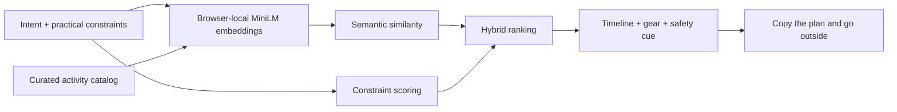

# I Built WanderWise: A Local-First AI Planner That Wants You to Close the Screen

Most AI products compete for more attention. I wanted to build one whose definition of success is getting closed.

**WanderWise AI** turns a sentence such as “I need a calm reset after work and I have one hour” into a small, practical outdoor plan. It recommends an activity, explains the match, divides the available time into three steps, lists what to bring, and gives one relevant safety reminder.

Then it asks you to put the phone away.

- **Live demo:** [WanderWise AI](https://wanderwise-ai.jagratbisht60.chatgpt.site)
- **Source code:** [Jagrat567/wanderwise-ai](https://github.com/Jagrat567/wanderwise-ai)

## The problem I wanted to solve

“Go outside” is good advice, but it is rarely actionable.

When someone is tired, restless, bored, or short on time, choosing an activity becomes another planning task. Search results make that worse: dozens of generic listicles, route pages, and recommendations create more screen time before the person ever reaches the door.

WanderWise asks for only five things:

1. What kind of outside experience do you need?
2. How much time do you have?
3. Who is coming?
4. What does the weather feel like?
5. How much energy do you have?

The answer is one plan, not another feed.

## What I built

The current version includes twelve curated outdoor activities, including:

- a slow “noticing walk” for a quiet reset;
- a twenty-bird sit for patient nature observation;
- a color-hunt photo safari for friends or families;
- a rain-listening loop for drizzly days;
- a neighborhood mapping expedition;
- a shade-to-shade loop for hot weather;
- a micro-hike for higher-energy users.

Each activity contains structured information about suitable weather, duration, energy, company, equipment, safety, and a three-part activity sequence.

The result is intentionally compact. A user can copy the plan, close the browser, and leave.

## Open-source AI is the matching engine

WanderWise uses the Apache-2.0-licensed `all-MiniLM-L6-v2` model through [Transformers.js](https://huggingface.co/docs/transformers.js/en/index).

The model runs in the browser. It converts the user's natural-language intention and each activity description into normalized 384-dimensional embeddings. Cosine similarity then measures which activity is semantically closest to what the user needs.

```javascript
const { pipeline } = await import(
  'https://cdn.jsdelivr.net/npm/@huggingface/transformers@3.8.1'
);

const extractor = await pipeline(
  'feature-extraction',
  'Xenova/all-MiniLM-L6-v2'
);

const output = await extractor(text, {
  pooling: 'mean',
  normalize: true,
});
```

This is not an AI label attached to an otherwise deterministic form. Semantic similarity is the primary signal used to rank the activity catalog.

## Why I used a hybrid ranker

Semantic similarity understands that “my head is noisy and I need to breathe” may fit a calm sensory walk even when the user never writes the word “relax.” But semantics alone cannot guarantee a practical recommendation.

A two-hour hill walk may sound perfect while still being wrong for someone with thirty minutes, low energy, and rain.

WanderWise therefore combines the model score with explicit constraints:

```text
final score =
  semantic similarity × 0.62
  + duration compatibility
  + weather compatibility
  + energy compatibility
  + company compatibility
```

This split gives the model the job it is good at—understanding intent—while ordinary code handles time, conditions, and safety.



## Why open innovation mattered here

The user's prompt can reveal mood, energy, social context, and routine. None of that needs to be sent to an AI server just to choose between a bird sit and a short hike.

Running an open model locally gave this project four concrete advantages:

- **Privacy:** the planning prompt stays in the browser.
- **No API key:** there is no account setup, token, or metered inference bill.
- **Inspectability:** the activity data, ranking weights, and model choice are visible in the source.
- **Replaceability:** another compatible embedding model can be tested without redesigning the product around a proprietary response format.

The static application has no user database, analytics SDK, or AI backend. Its service worker caches the app shell after the first visit. The model itself is downloaded on first use and cached by the browser.

## Building for failure, not just the demo

The most useful bug appeared during live deployment.

My first model configuration pointed Transformers.js at an ONNX repository that did not contain the quantized filename the runtime requested. The page still returned a useful activity because I had already built a transparent lexical-and-constraint fallback—but the interface correctly labeled it **Fallback match**, not AI.

Browser logs exposed the missing model file. I switched to the browser-compatible `Xenova/all-MiniLM-L6-v2` distribution documented by Transformers.js, versioned the cached assets, and tested again. The deployed app then reported:

```text
all-MiniLM-L6-v2 is ready · inference stays on this device.
```

The same rainy-day request produced an **AI match** for “A rain-listening loop.”

That failure changed the final product in three ways:

1. Model loading has visible progress instead of a mysterious spinner.
2. The fallback is labeled honestly.
3. Service-worker assets are versioned so returning users receive model fixes.

## The “shortest screen” design

The interaction is deliberately not a chatbot.

A chat interface invites another question. WanderWise uses one small form and one recommendation card. The card contains only what someone needs outside:

- a reason the activity fits;
- three timed steps;
- a tiny equipment list;
- one safety cue;
- a copy button;
- one alternative.

The visual system uses forest green, warm cream, leaf green, and trail orange. The illustration and field-note styling make the page feel like the beginning of an outing rather than another productivity dashboard.

## Taking it outside

I ran a focused recommendation check with the prompt **“just nature and lakes.”** WanderWise suggested **“A micro-hike with a summit.”**

That result was useful because it was only a partial match: the hike fits the broad nature intent, but a summit does not honor the explicit lake preference strongly enough. It exposed the next evaluation target for the hybrid ranker—specific landscape words such as “lake,” “river,” and “forest” should outweigh a merely adjacent outdoor activity.

I have not presented this as a physical outdoor field test. The challenge lists field testing as bonus work, and an honest software test is more useful than inventing an outing that did not happen. A future field test will compare the recommendation with the actual place, conditions, and experience, without publishing a precise location.

## What I would build next

The current version asks the user to describe the weather instead of requesting location access. That is intentional for the first release.

Future experiments could include:

- optional, privacy-preserving weather retrieval;
- accessibility and mobility preferences;
- downloadable activity packs for different climates;
- community-authored activity catalogs;
- an IndexedDB model cache with clearer storage controls;
- lightweight evaluation data for measuring recommendation quality.

I would keep route generation out of the core unless it can be made safe and verifiable. WanderWise should recommend a kind of outing, not hallucinate a trail.

## What I learned

The biggest lesson was that useful AI does not have to generate paragraphs.

A small embedding model, a carefully designed local dataset, and transparent rules were enough to solve the actual product problem. The result is faster to understand, easier to test, cheaper to operate, and more private than a cloud chatbot.

More importantly, it knows when the interaction should end.

If WanderWise works, the best part of the experience happens after the tab is closed.

## Credits and references

- [Transformers.js documentation](https://huggingface.co/docs/transformers.js/en/index)
- [`all-MiniLM-L6-v2` model family](https://huggingface.co/sentence-transformers/all-MiniLM-L6-v2)
- [How I built privacy-first file tools that run AI models directly in your browser](https://dev.to/trantanhau/how-i-built-privacy-first-file-tools-that-run-ai-models-directly-in-your-browser-1557) by Tran Tan Hau
- [Why “Local-First” Is the New Stack](https://dev.to/tamizuddin/why-local-first-is-the-new-stack-how-to-build-data-sovereign-ai-apps-with-local-llms-private-2m5l) by Tamizuddin

The application code is available under the MIT License. AI-assisted development and writing are disclosed on this submission.

This is a solo submission by [Jagrat Bisht](https://dev.to/jagrat_bisht_eb5bb5aaec84).

