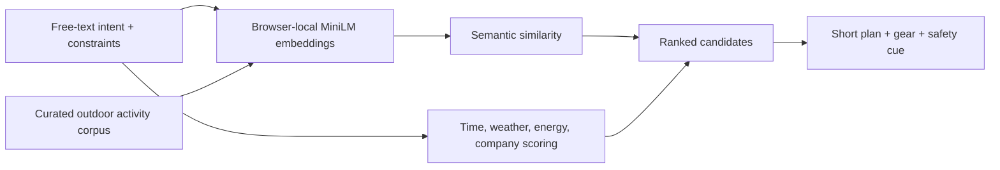

# WanderWise AI

WanderWise is a privacy-first outdoor activity planner built for the **Hacktoberfest Open-Source AI Challenge: Week 1 — Touch Grass**.

It turns a free-text intention—such as “a quiet reset after work”—plus time, energy, company, and weather into a short outdoor plan. The app uses the Apache-2.0-licensed `all-MiniLM-L6-v2` model through Transformers.js to calculate semantic similarity entirely in the browser. No prompt is sent to an AI API.

## Run locally

Serve the `dist` directory with any static server:

```bash
npx serve dist
```

The model is downloaded from Hugging Face on first use and cached by the browser. If it cannot load, the app explains that it has switched to a transparent lexical matcher instead of failing.

## How it works



The AI is intentionally narrow: it finds the semantic fit between a person's natural-language need and a curated activity corpus. Deterministic constraint scoring then makes the result practical and explainable.

## Privacy and resilience

- Prompts and preferences remain in the browser.
- There is no account, analytics SDK, backend, or API key.
- The app shell works offline after the first visit.
- A built-in fallback remains usable when the model CDN is unavailable.

## Challenge alignment

- **Open-source AI at the core:** local sentence embeddings drive activity selection.
- **Gets people away from screens:** every result is a compact timeline designed to be copied and taken outside.
- **Open advantage:** private intentions never need to leave the device.
- **Technical execution:** responsive, accessible, model-progress-aware, and resilient to network/model failures.

## License

The application source is licensed under MIT. The model used by the application has its own Apache-2.0 license.

